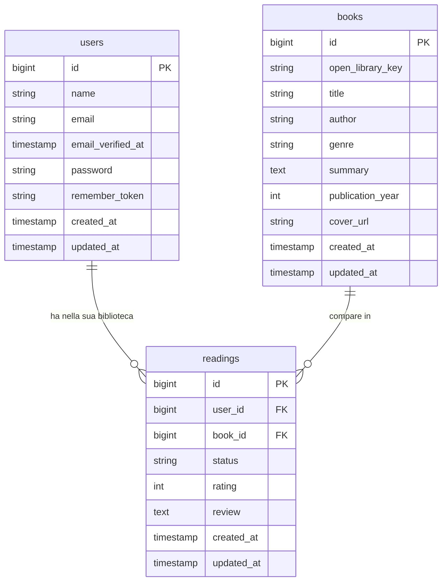

# Booklist

## Relazioni

- Un **utente** può avere molte **letture** (`users` 1 → N `readings`).
- Un **libro** può comparire in molte letture, di utenti diversi (`books` 1 → N `readings`).
- Di conseguenza `users` e `books` sono in relazione **molti a molti**, attraverso `readings`.
